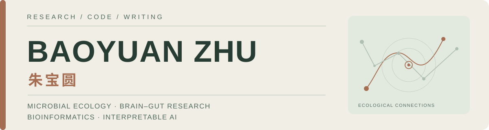

<!--
GitHub Profile README.
Copy this README.md and its assets/ folder to the root of a public repository
named exactly zbyloveyj, owned by the GitHub account zbyloveyj.
GitHub automatically places the rendered README above pinned repositories
on https://github.com/zbyloveyj .
-->
<picture>
  <source media="(prefers-color-scheme: dark)" srcset="assets/profile-banner-dark.svg">
  <source media="(prefers-color-scheme: light)" srcset="assets/profile-banner-light.svg">
  
</picture>

  <a href="https://zbyloveyj.github.io/"><strong>Academic Website</strong></a> &nbsp;·&nbsp;
  <a href="https://zbyloveyj.github.io/research.html">Research</a> &nbsp;·&nbsp;
  <a href="https://zbyloveyj.github.io/publications.html">Publications</a> &nbsp;·&nbsp;
  <a href="https://zbyloveyj.github.io/projects.html">Open Science</a> &nbsp;·&nbsp;
  <a href="https://zbyloveyj.github.io/assets/Baoyuan_Zhu_Academic_CV.pdf">CV</a>

### Hello / 你好 👋

I'm **Baoyuan Zhu (朱宝圆)**, a PhD candidate at **South China University of Technology**. I develop computational approaches to investigate **microbial ecosystems, psychiatric heterogeneity, brain–gut associations and interpretable biomedical AI**. I care about transparent analyses and evidence that survives independent validation.

我是**朱宝圆**，华南理工大学博士研究生。关注**微生物生态、精神疾病异质性、脑肠关联和可解释人工智能**，希望通过可复现的计算分析，在不同人群、不同测量和多个生物学尺度之间建立可信的联系。

### Research interests / 研究方向

- **Microbial ecology · 微生物生态** — large-scale metagenomics, continuous ecological factors and reference-based models.
- **Brain–gut systems · 脑肠关联** — microbial patterns associated with symptoms, cognition and neuroimaging.
- **Computational biology · 计算生物学** — multi-omics integration, microbial genetics and interpretable statistical learning.

### Selected publications / 代表论文

**Biological Psychiatry · 2026 · Ahead of print (Journal Pre-proof)**  
[Connection-Level Multi-Omics Reveals Cerebellar-Cortical Dysconnectivity and Divergent Molecular Signatures Across Major Psychiatric Disorders](https://doi.org/10.1016/j.biopsych.2026.09.020)  
BrainNetAnno · Connection-level multi-omics annotation · Published online 3 October 2026 · Co-author (third-listed author)

**2026 · Advanced Science**  
[Dissecting the Ecological Structure of Health and Disease in the Global Gut Microbiome](https://doi.org/10.1002/advs.202517087)  
Microbial ecological variation across 20,178 metagenomes from 36 countries.

**2026 · Research**  
[The Brain–Gut Health Initiative (BIGHI): A Prospective Cohort on Psychiatric Disorders in China](https://doi.org/10.34133/research.1142)  
Prospective multimodal infrastructure for psychiatric brain–gut research.

**2025 · Translational Psychiatry**  
[Multi-kingdom microbial changes and their associations with the clinical characteristics in schizophrenia patients](https://doi.org/10.1038/s41398-025-03449-6)  
Multi-kingdom microbial signatures and clinical associations.

[See all selected papers and citation exports →](https://zbyloveyj.github.io/publications.html)

### Open research & projects / 科研代码与开放资源

| Project | Focus |
| :-- | :-- |
| [Microbial Ecological Factors](https://github.com/zbyloveyj/SCUT_Minilab_MEF) | Ecological factor modeling of gut microbiome variation · 微生物生态因子 |
| [CLEAR-Microbiome](https://github.com/zbyloveyj/CLEAR-Microbiome) | Contrastive learning for microbiome–clinical associations · 对比表征学习 |
| [Normative Microbial Networks](https://github.com/zbyloveyj/Normative-Microbial-Network-Modeling-Framework) | Healthy-reference network and ecological deviation research · 规范生态网络 |
| [BioAgentLab](https://github.com/zbyloveyj/BioAgentLab) | Evidence-aware research agents and educational materials · 科研智能体 |

Research software and educational projects have different levels of validation. Please check each repository's documentation.

### Beyond the lab / 科研之外

I enjoy scientific writing, open learning resources and the history of discovery. I am also **happily in a relationship**, and value the ordinary life outside research.

科研之外，我喜欢科学写作、知识分享，也很珍惜**和对象一起的日常生活**。正在持续创作[《看不见的文明》](https://zbyloveyj.github.io/invisible-civilization/)和[《从读研到做研究》](https://zbyloveyj.github.io/graduate-research-handbook/)。

---

**Contact / 联系** &nbsp; [Email](mailto:18851970329@163.com) · [ORCID](https://orcid.org/0009-0006-6213-214X) · [Academic Website](https://zbyloveyj.github.io/)  
Baoyuan Zhu · Research, code & writing · Updated October 2026
