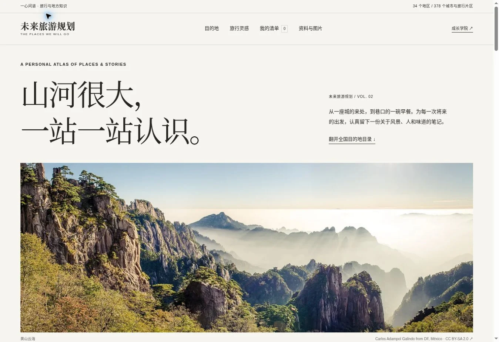

# 未来旅游规划

独立静态页面：`https://zbyloveyj.github.io/personal-growth-lab/academy/travel-plans/`。

覆盖34个省级地区、262个代表目的地；安徽16市、广东21市完整收录，台湾、香港和澳门独立展开。不是全国全部县市乡镇的穷尽目录。

## 使用

按地区或关键词检索；选择地区阅读景点、历史人文、美食、季节与路线；点击“加入想去”，在清单中设置想去/已去、月份、天数和笔记。可导出JSON备份、合并导入、下载个人清单、下载地区攻略、打印当前地区。

个人数据仅保存在浏览器localStorage，不写入仓库；不同设备不自动同步。无登录、无跟踪、无第三方脚本或字体。

## 内容

`data.json` 为结构化内容；`data.js` 为同源浏览器数据；`index.html` 包含静态全文，禁用JavaScript仍可阅读；`全国旅游攻略.md` 为可下载全文；`sources.html` 提供参考与官方核验入口。

路线为编辑建议，门票、班次、灾后开放和出行资格不作为固定事实写入。编写日期2026-11-08。

## 页面风格

黑白编辑式排版、编号地区索引、实景摄影与衬线标题。视觉研究参考Blackstone和KKR官网，不使用其品牌资产。摄影来源和CC BY-SA 2.0授权见 `assets/CREDITS.md`。

